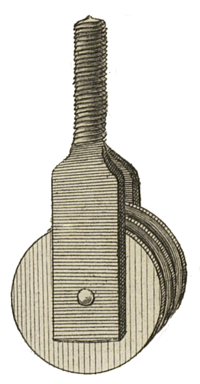

<table>
<tr>
<td></td>
<td align="left">
<h1 style="margin:0">MoveTo</h1>

<strong>Senden nach… · Dateibrowser · KOReader</strong> Plugin · Verschieben · Sidecars / Verlauf

</td>
</tr>
</table>

  
Entwickelt von <a href="https://atelier.atechnologie.fr/">l'Atelier</a> — Buchherstellung und Forschungswerkzeuge (EHESS)

🇫🇷 <a href="README.md">Français</a> ·
🇬🇧 <a href="README.en.md">English</a> ·
🇩🇪 <a href="README.de.md"><b>Deutsch</b></a> ·
🇪🇸 <a href="README.es.md">Español</a>

---

## 📸 Vorschau

| Menü | Verschieben |
| :---: | :---: |
|  |  |

## 📖 Über

KOReader-Plugin, das dem Langdruck-Menü des Dateibrowsers **Senden nach…** hinzufügt, um eine Datei oder einen Ordner in ein konfiguriertes Zielverzeichnis zu verschieben.

## 📋 Voraussetzungen

- KOReader **2025.04** oder neuer (`FileManager:addFileDialogButtons`)

## ⬇️ Installation

1. Diesen Ordner nach `koreader/plugins/moveto.koplugin/` kopieren  
   (Ordnername muss `moveto.koplugin` sein, nicht `ATmoveto.koplugin`)
2. KOReader neu starten
3. Prüfen, dass das Plugin aktiv ist: *Werkzeuge → Plugin management*

## ⚙️ Konfiguration

1. Menü öffnen → **Werkzeuge → Move to**
2. **Ordner wählen…** und das Zielverzeichnis auswählen

Der Pfad wird in den KOReader-Einstellungen gespeichert (`moveto_target_dir`).

## ✏️ Nutzung

1. Langer Druck auf eine Datei oder einen Ordner
2. **Senden nach „…“** tippen
3. Verschieben bestätigen

Das Verschieben aktualisiert Sidecars (`.sdr`), Verlauf und Sammlungen wie Ausschneiden / Einfügen.

## 📦 Dateien

| Datei | Rolle |
|-------|------|
| `_meta.lua` | Plugin-Metadaten |
| `main.lua` | Menü, Einstellungen, Verschieben |

## 🔗 Ressourcen

| | |
| --- | --- |
| 🌐 **l'Atelier** | [atelier.atechnologie.fr](https://atelier.atechnologie.fr/) |
| 📦 **Repository** | [github.com/Morglaf/ATmoveto.koplugin](https://github.com/Morglaf/ATmoveto.koplugin) |
| 📖 **KOReader** | [github.com/koreader/koreader](https://github.com/koreader/koreader) |

---

🇫🇷 <a href="README.md">Français</a> · <a href="README.en.md">🇬🇧 English</a> · <a href="README.de.md">🇩🇪 Deutsch</a> · <a href="README.es.md">🇪🇸 Español</a> · MoveTo — <a href="https://atelier.atechnologie.fr/">l'Atelier</a>

