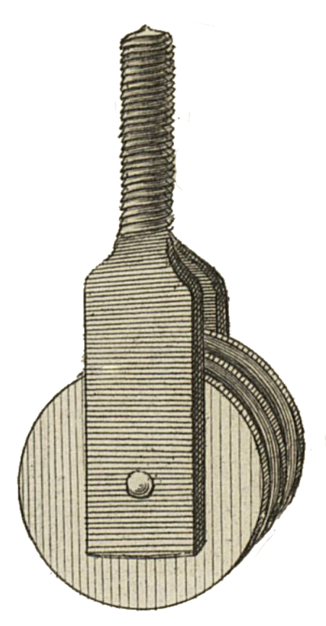

<table>
<tr>
<td></td>
<td align="left">
<h1 style="margin:0">MoveTo</h1>

<strong>Send to… · File browser · KOReader</strong> Plugin · move files · sidecars / history

</td>
</tr>
</table>

  
Developed by <a href="https://atelier.atechnologie.fr/">l'Atelier</a> — book fabrication and research tools (EHESS)

🇫🇷 <a href="README.md">Français</a> ·
🇬🇧 <a href="README.en.md"><b>English</b></a> ·
🇩🇪 <a href="README.de.md">Deutsch</a> ·
🇪🇸 <a href="README.es.md">Español</a>

---

## 📸 Preview

| Menu | Move |
| :---: | :---: |
|  |  |

## 📖 About

KOReader plugin that adds **Send to…** to the file browser long-press menu, to move a file or folder to a configured target directory.

## 📋 Requirements

- KOReader **2025.04** or newer (`FileManager:addFileDialogButtons`)

## ⬇️ Installation

1. Copy this folder to `koreader/plugins/moveto.koplugin/`  
   (the folder name must be `moveto.koplugin`, not `ATmoveto.koplugin`)
2. Restart KOReader
3. Check that the plugin is enabled: *Tools → Plugin management*

## ⚙️ Configuration

1. Open the menu → **Tools → Move to**
2. **Choose folder…** and select the target directory

The path is stored in KOReader settings (`moveto_target_dir`).

## ✏️ Usage

1. Long-press a file or folder
2. Tap **Send to “…”**
3. Confirm the move

The move updates sidecars (`.sdr`), history and collections, like Cut / Paste.

## 📦 Files

| File | Role |
|------|------|
| `_meta.lua` | Plugin metadata |
| `main.lua` | Menu, settings, move logic |

## 🔗 Resources

| | |
| --- | --- |
| 🌐 **l'Atelier** | [atelier.atechnologie.fr](https://atelier.atechnologie.fr/) |
| 📦 **Repository** | [github.com/Morglaf/ATmoveto.koplugin](https://github.com/Morglaf/ATmoveto.koplugin) |
| 📖 **KOReader** | [github.com/koreader/koreader](https://github.com/koreader/koreader) |

---

🇫🇷 <a href="README.md">Français</a> · <a href="README.en.md">🇬🇧 English</a> · <a href="README.de.md">🇩🇪 Deutsch</a> · <a href="README.es.md">🇪🇸 Español</a> · MoveTo — <a href="https://atelier.atechnologie.fr/">l'Atelier</a>

