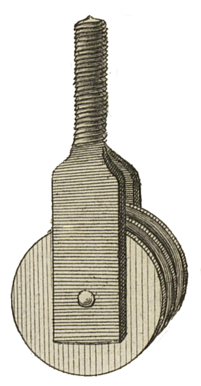

<table>
<tr>
<td></td>
<td align="left">
<h1 style="margin:0">MoveTo</h1>

<strong>Enviar a… · Explorador de archivos · KOReader</strong> Plugin · mover · sidecars / historial

</td>
</tr>
</table>

  
Desarrollado por <a href="https://atelier.atechnologie.fr/">l'Atelier</a> — fabricación de libros y herramientas de investigación (EHESS)

🇫🇷 <a href="README.md">Français</a> ·
🇬🇧 <a href="README.en.md">English</a> ·
🇩🇪 <a href="README.de.md">Deutsch</a> ·
🇪🇸 <a href="README.es.md"><b>Español</b></a>

---

## 📸 Vista previa

| Menú | Mover |
| :---: | :---: |
|  |  |

## 📖 Acerca de

Plugin KOReader que añade **Enviar a…** al menú de pulsación larga del explorador de archivos, para mover un archivo o carpeta a un directorio destino configurado.

## 📋 Requisitos

- KOReader **2025.04** o más reciente (`FileManager:addFileDialogButtons`)

## ⬇️ Instalación

1. Copie esta carpeta a `koreader/plugins/moveto.koplugin/`  
   (el nombre debe ser `moveto.koplugin`, no `ATmoveto.koplugin`)
2. Reinicie KOReader
3. Compruebe que el plugin está activo: *Herramientas → Plugin management*

## ⚙️ Configuración

1. Abrir el menú → **Herramientas → Move to**
2. **Elegir carpeta…** y seleccionar el directorio destino

La ruta se guarda en los ajustes de KOReader (`moveto_target_dir`).

## ✏️ Uso

1. Pulsación larga sobre un archivo o carpeta
2. Tocar **Enviar a « … »**
3. Confirmar el desplazamiento

El movimiento actualiza sidecars (`.sdr`), historial y colecciones, como Cortar / Pegar.

## 📦 Archivos

| Archivo | Función |
|---------|---------|
| `_meta.lua` | Metadatos del plugin |
| `main.lua` | Menú, ajustes, desplazamiento |

## 🔗 Recursos

| | |
| --- | --- |
| 🌐 **l'Atelier** | [atelier.atechnologie.fr](https://atelier.atechnologie.fr/) |
| 📦 **Repositorio** | [github.com/Morglaf/ATmoveto.koplugin](https://github.com/Morglaf/ATmoveto.koplugin) |
| 📖 **KOReader** | [github.com/koreader/koreader](https://github.com/koreader/koreader) |

---

🇫🇷 <a href="README.md">Français</a> · <a href="README.en.md">🇬🇧 English</a> · <a href="README.de.md">🇩🇪 Deutsch</a> · <a href="README.es.md">🇪🇸 Español</a> · MoveTo — <a href="https://atelier.atechnologie.fr/">l'Atelier</a>

