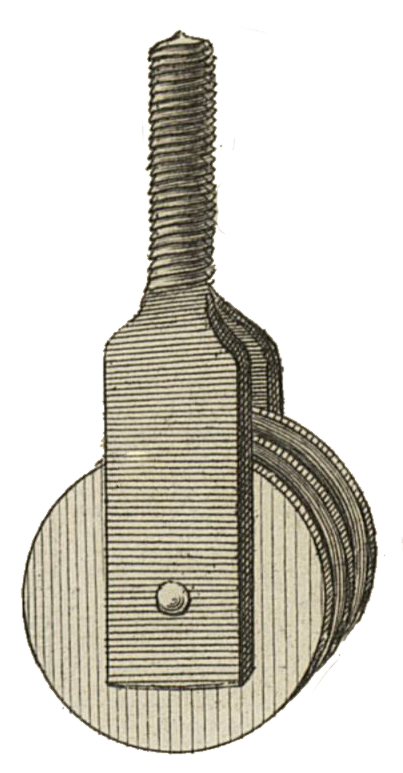

<table>
<tr>
<td></td>
<td align="left">
<h1 style="margin:0">MoveTo</h1>

<strong>Envoyer vers… · Navigateur de fichiers · KOReader</strong> Plugin · déplacement · sidecars / historique

</td>
</tr>
</table>

  
Développé par <a href="https://atelier.atechnologie.fr/">l'Atelier</a> — fabrication de livres et outils de recherche (EHESS)

🇫🇷 <a href="README.md"><b>Français</b></a> ·
🇬🇧 <a href="README.en.md">English</a> ·
🇩🇪 <a href="README.de.md">Deutsch</a> ·
🇪🇸 <a href="README.es.md">Español</a>

---

## 📸 Aperçu

| Menu | Déplacement |
| :---: | :---: |
|  |  |

## 📖 À propos

Plugin KOReader qui ajoute **Envoyer vers…** au menu d’appui long du navigateur de fichiers, pour déplacer un fichier ou un dossier vers un répertoire cible configuré.

## 📋 Prérequis

- KOReader **2025.04** ou plus récent (`FileManager:addFileDialogButtons`)

## ⬇️ Installation

1. Copier ce dossier en `koreader/plugins/moveto.koplugin/`  
   (le nom du dossier doit être `moveto.koplugin`, pas `ATmoveto.koplugin`)
2. Redémarrer KOReader
3. Vérifier que le plugin est activé : *Outils → Plugin management*

## ⚙️ Configuration

1. Ouvrir le menu → **Outils → Move to**
2. **Choisir le dossier…** et sélectionner le répertoire cible

Le chemin est enregistré dans les réglages KOReader (`moveto_target_dir`).

## ✏️ Utilisation

1. Appui long sur un fichier ou un dossier
2. Toucher **Envoyer vers « … »**
3. Confirmer le déplacement

Le déplacement met à jour les sidecars (`.sdr`), l’historique et les collections, comme Couper / Coller.

## 📦 Fichiers

| Fichier | Rôle |
|---------|------|
| `_meta.lua` | Métadonnées du plugin |
| `main.lua` | Menu, paramètres, déplacement |

## 🔗 Ressources

| | |
| --- | --- |
| 🌐 **l'Atelier** | [atelier.atechnologie.fr](https://atelier.atechnologie.fr/) |
| 📦 **Dépôt** | [github.com/Morglaf/ATmoveto.koplugin](https://github.com/Morglaf/ATmoveto.koplugin) |
| 📖 **KOReader** | [github.com/koreader/koreader](https://github.com/koreader/koreader) |

---

🇫🇷 <a href="README.md">Français</a> · <a href="README.en.md">🇬🇧 English</a> · <a href="README.de.md">🇩🇪 Deutsch</a> · <a href="README.es.md">🇪🇸 Español</a> · MoveTo — <a href="https://atelier.atechnologie.fr/">l'Atelier</a>

